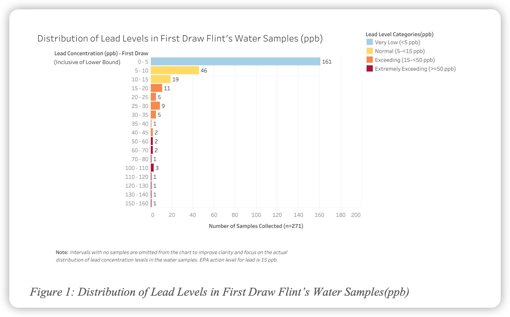
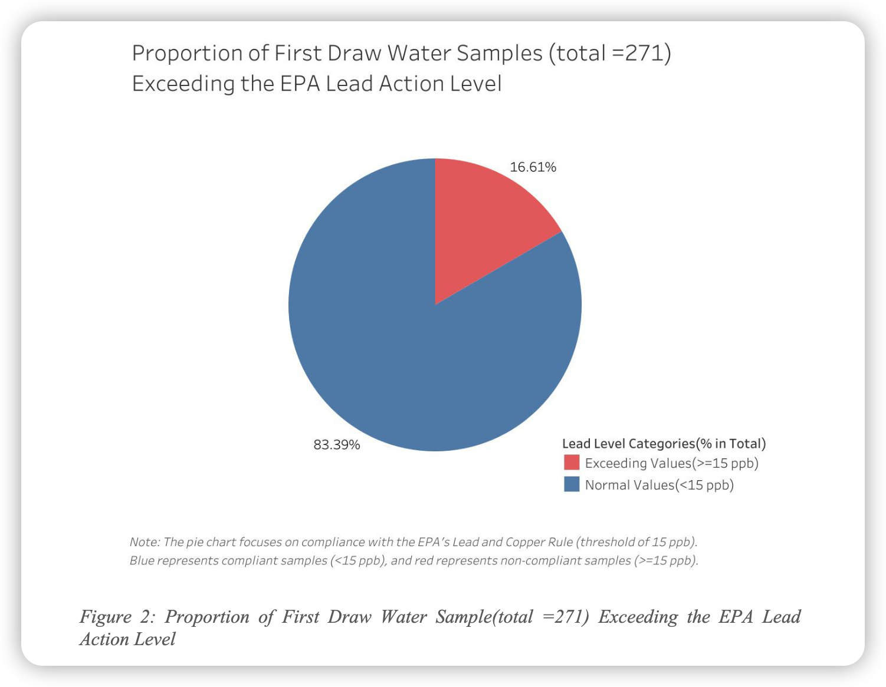
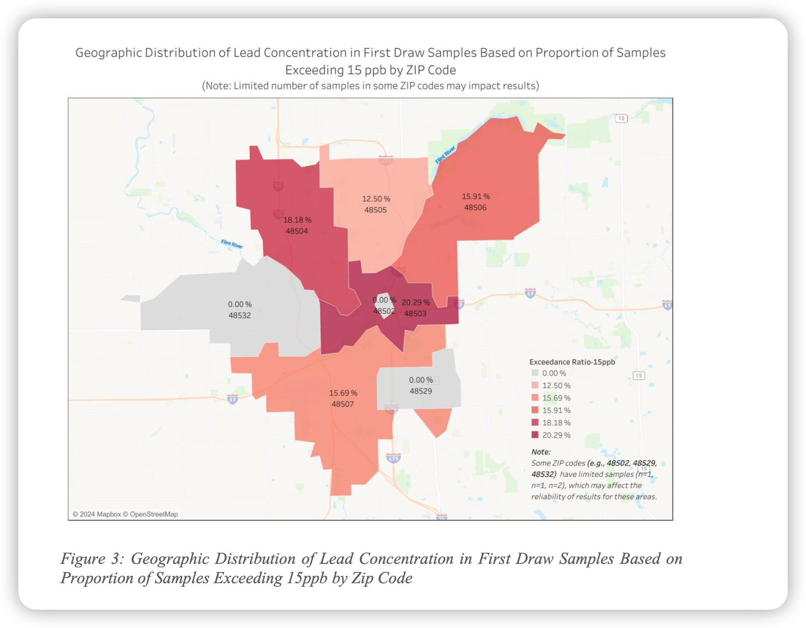
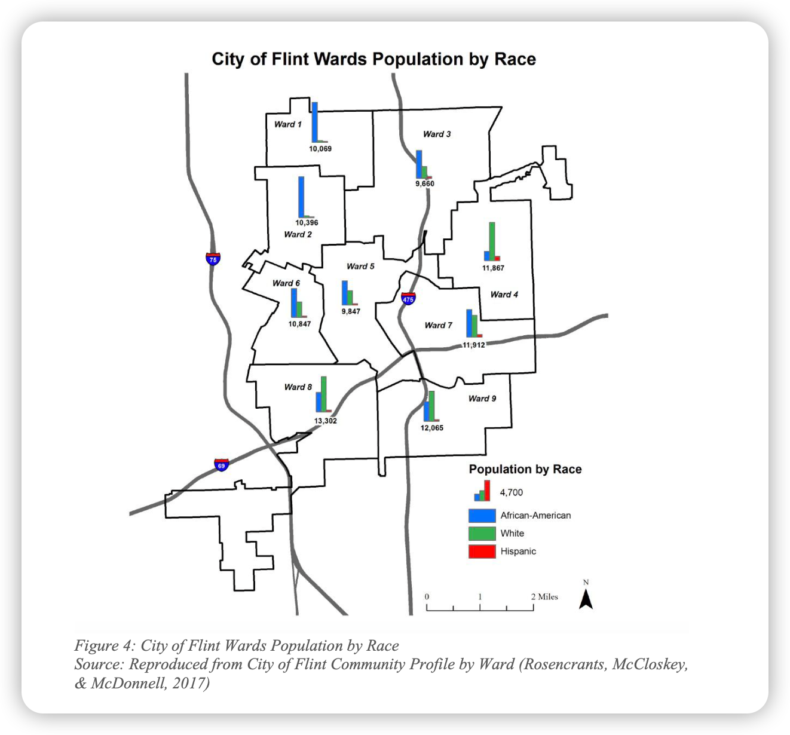
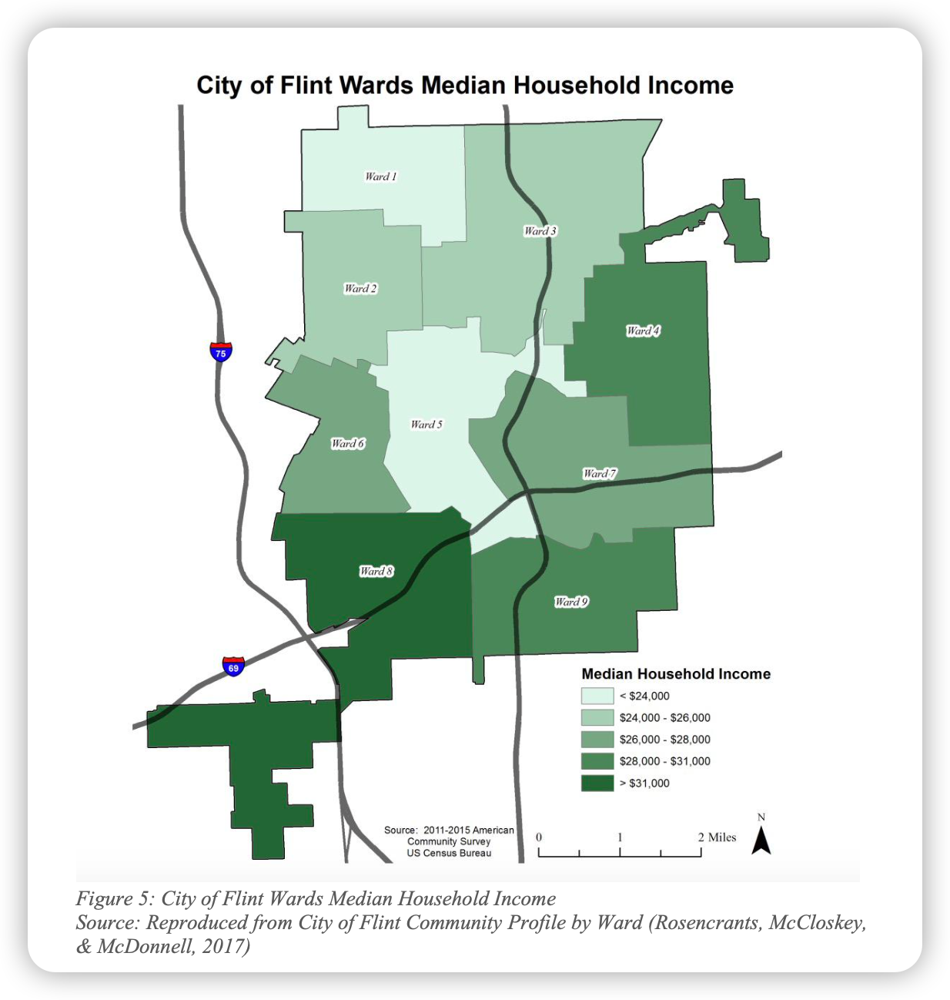

# Flint Water Crisis Analysis
### 美国弗林特水危机：水质污染数据分析与可视化

## 1. 项目简介（Project Overview）

本项目基于美国弗林特水危机的 **271份水质采样数据**，使用 **Tableau** 进行数据分析与交互式可视化，重点研究水样铅浓度分布、达到或超过参考阈值的样本比例，以及不同地区的污染差异。

通过分组柱状图、占比图和地理分布地图展示关键指标，并结合人口结构与家庭收入等外部资料，探讨水质污染的空间分布特征及潜在社会影响。

## 2. 使用工具与技能（Tools & Skills）

- **数据可视化：** Tableau
- **数据分析：** 描述性统计、分组统计、比例分析、区域对比
- **可视化方法：** 分组柱状图、饼图、分级设色地图（Choropleth Map）
- **核心能力：** 指标定义、数据分析、可视化设计、数据洞察

## 3. 数据来源（Dataset）

本项目使用美国弗吉尼亚理工大学 Flint Water Study 团队公布的水质采样数据。

- **数据规模：** 271份水质采样记录
- **主要字段：** Pb Bottle 1、Pb Bottle 2、Pb Bottle 3、ZIP Code
- **主要分析对象：** 首次取水样本（First Draw Samples）
- **参考阈值：** 15 ppb，用于分析样本达到或超过相关行动水平的情况

**数据来源：**
[Flint Water Study – Complete Dataset](https://flintwaterstudy.org/2015/12/complete-dataset-lead-results-in-tap-water-for-271-flint-samples/)

## 4. 主要分析内容（Analysis & Visualization）

### 4.1 铅浓度分布分析

使用分组柱状图展示271份首次取水样本在不同铅浓度区间的分布情况。

根据数据分布特征，对低于50 ppb的样本采用较小的浓度区间，对较高浓度样本采用较大的区间，以突出主要分布特征及高浓度样本。

*图1：首次取水样本的铅浓度区间分布（本人使用Tableau制作）*

**主要观察：**

- 大部分样本集中在较低的铅浓度区间。
- 少数样本达到较高浓度，呈现明显的长尾分布。
- 通过分组统计可以更直观地识别高浓度样本。

### 4.2 铅浓度超标比例分析

以 **15 ppb** 作为分析参考阈值，统计首次取水样本中达到或超过该水平的比例。

*图2：271份首次取水样本中达到或超过15 ppb的比例（本人使用Tableau制作）*

**分析结果：**

- **样本总数：** 271份
- **达到或超过15 ppb的比例：** 16.61%
- **低于15 ppb的比例：** 83.39%

该结果说明，在所分析的水样中，仍有一定比例的样本达到或超过参考行动水平。

需要注意，样本比例并不直接等同于整个城市供水系统的监管合规结论。

### 4.3 地理分布分析

使用分级设色地图（Choropleth Map）展示不同ZIP Code区域中达到或超过15 ppb的样本比例。

通过颜色深浅区分各地区的样本超标比例，观察污染分布的空间差异。

*图3：不同ZIP Code区域中达到或超过15 ppb的样本比例（本人使用Tableau制作）*

**主要发现：**

- 不同ZIP Code区域的样本超标比例存在差异。
- ZIP Code **48503** 的样本超标比例约为 **20.29%**。
- ZIP Code **48504** 的样本超标比例约为 **18.18%**。
- 部分地区样本量较少，区域比例可能受到个别样本的较大影响。

因此，地理分布结果主要用于探索性分析，不能直接代表各区域整体居民的实际暴露水平。

### 4.4 社会经济背景分析

为进一步理解水质污染的社会背景，本项目参考了弗林特市不同Ward的人口结构与家庭收入资料，并与水质污染分布进行对比讨论。

#### 4.4.1 人口结构分布

下图展示弗林特市不同Ward的人口结构，用于了解各地区的人口分布背景。

*图4：弗林特市各Ward人口结构分布。引用外部资料，非本人制作。*

#### 4.4.2 家庭收入分布

下图展示弗林特市不同Ward的家庭收入中位数分布，用于辅助讨论不同地区的社会经济差异。

*图5：弗林特市各Ward家庭收入中位数分布。引用外部资料，非本人制作。*

**图4、图5来源：**

Rosencrants, T., McCloskey, M. & McDonnell, S. (2017). *City of Flint Community Profile by Ward*.

[查看原始资料](https://mapflint.org/research/CityOfFlintCommunityProfiles.pdf)

**分析说明：**

结合污染地图与外部资料，可以对污染较严重地区的社会经济背景进行探索性讨论。

但污染数据按ZIP Code统计，而人口与收入数据按Ward统计，两者的地理边界并不完全一致。因此，本项目不将这种空间对比解释为严格的统计相关性或因果关系。

## 5. 主要发现（Key Findings）

通过数据分析与可视化，本项目得到以下主要发现：

**1. 铅浓度分布存在明显差异**

大部分样本集中在较低浓度区间，但仍存在少数高浓度样本，需要在分析中单独关注。

**2. 部分水样达到或超过15 ppb参考阈值**

在271份首次取水样本中，16.61%的样本达到或超过15 ppb，反映出所分析样本中存在值得关注的铅暴露风险。

**3. 不同区域的样本超标比例存在差异**

ZIP Code 48503和48504在本次分析中表现出较高的样本超标比例，但部分地区样本量有限，结果需要谨慎解释。

**4. 污染问题具有值得进一步研究的社会背景**

结合人口结构与家庭收入资料，可以进一步讨论环境污染与社会经济差异之间的潜在联系，但现有数据不足以证明因果关系。

## 6. 项目成果（Deliverables）

本项目完成了以下分析与可视化成果：

- 铅浓度区间分布图
- 铅浓度参考阈值占比图
- ZIP Code区域污染分布地图
- 社会经济背景对比分析
- 数据可视化分析报告

通过Tableau可视化与描述性统计，将原始水质采样数据转化为便于理解的图表与分析结果。

## 7. 项目局限性（Limitations）

- **样本代表性：** 数据主要来自居民参与的水质采样，不能保证完全代表全市所有住户。
- **区域样本量：** 部分ZIP Code的样本量较少，可能影响区域超标比例的稳定性。
- **极端值影响：** 少数高浓度样本可能对总体统计指标产生较大影响。
- **地理口径差异：** ZIP Code与Ward边界不同，社会经济背景对比仅用于探索性讨论。
- **因果关系：** 本项目属于描述性与探索性分析，不进行因果推断。

## 8. 项目说明（Notes）

本项目为曼彻斯特大学数据可视化相关课程的学术项目，基于公开水质数据完成分析。

**本人制作：**
- 图1：铅浓度分布图
- 图2：铅浓度超标比例图
- 图3：ZIP Code污染分布地图

**引用外部资料：**
- 图4：人口结构地图
- 图5：家庭收入地图

外部图片仅用于背景分析，原始来源已在对应章节注明。

**数据来源：** Flint Water Study  
**可视化工具：** Tableau
